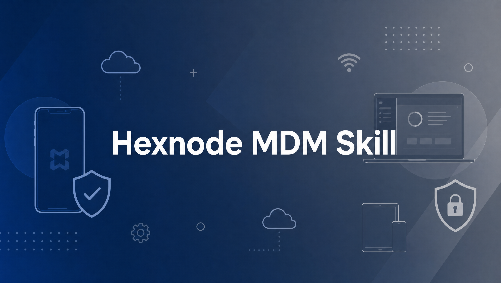

<div align="center">



# Hexnode MDM Skill

Knowledge and workflows for AI agents working with Hexnode UEM/MDM.

</div>

## Overview

This skill helps with enrollment, policies, automation, scripting, API integrations, wildcards, app management, kiosk, compliance, troubleshooting and migration. It covers Apple, Android, Windows, Linux, ChromeOS, Zebra printers and other supported platforms, with guidance to check the device, tenant and enrollment prerequisites for each feature.

The skill prioritizes current Hexnode documentation and provides targeted references rather than loading all product knowledge at once. The sources in the current references were reviewed on 2026-11-13.

## Installation

Clone the repository and copy it as a skill folder, including `references/`. For example, from the parent directory, **if the destination does not already exist**:

```bash
git clone https://github.com/safernandez666/hexnode-mdm-skill.git
mkdir -p "$HOME/.agents/skills"
cp -R ./hexnode-mdm-skill "$HOME/.agents/skills/hexnode-mdm"
```

If a skill already exists at the destination, back it up or review it before replacement. Skill discovery paths depend on the agent; see [INSTALL.md](INSTALL.md) for details.

Try prompts such as:

- “How do I enroll supervised iPads with Hexnode?”
- “My macOS script is pending in Hexnode; how do I troubleshoot it?”
- “How do I list devices across all API pages?”
- “How can I connect Hexnode compliance with Microsoft Entra?”

## Structure

- [SKILL.md](SKILL.md) — agent instructions and reference map.
- [API and integrations](references/api.md) — authentication, endpoints, pagination, automations and webhooks.
- [Enrollment and platforms](references/platforms.md) — enrollment models, platform prerequisites and migration.
- [Automation and scripts](references/automation.md) — triggers, wildcards, secure credential handling and troubleshooting.
- [Policies and operations](references/operations.md) — apps, kiosk, compliance, patching, security and integrations.

### Historical material

[The previous skill](references/legacy-skill.md), [API_REFERENCE.md](API_REFERENCE.md), [HEXNODE_API_COMPLETE.md](HEXNODE_API_COMPLETE.md), `hexnode_api_complete_docs.json` and [SKILL_REVIEW_REPORT.md](SKILL_REVIEW_REPORT.md) are retained as historical snapshots. They contain outdated or incomplete claims, and the previous skill includes unsafe credential-handling guidance. Consult the current references and official documentation before reusing them.

## Validation and sources

Product capabilities, API behavior and UI labels vary by platform, plan, enrollment and release. Validate changes on a pilot group and verify per-device results. The references link to [Hexnode Help](https://www.hexnode.com/mobile-device-management/help/) and the [developer documentation](https://www.hexnode.com/mobile-device-management/developers/). No tenant access or end-to-end deployment is implied by documentation examples.

## License

The earlier repository documentation contained conflicting licensing statements and no license file. Contact the maintainer before redistributing until the license is clarified.
